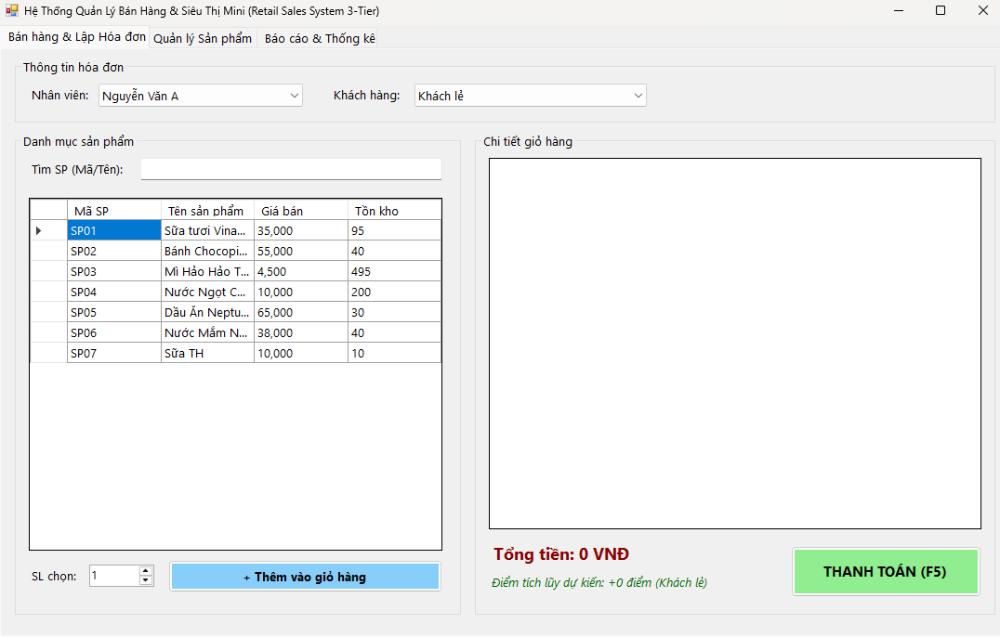
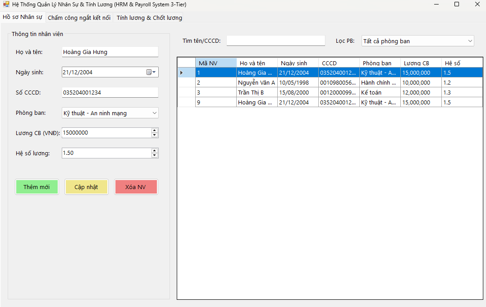

# BÁO CÁO BÀI TẬP THỰC HÀNH LẬP TRÌNH C# WINFORMS

## MỤC 1: THÔNG TIN SINH VIÊN
- **Họ và tên sinh viên:** Hoàng Gia Hưng
- **Mã sinh viên:** 24810320102
- **Lớp học phần:** D19QTANM1
- **Tên Đề tài / Bài tập:** Bài tập Thực hành C# WinForms (Bài 6.1 & Bài 6.2)
- **Link Repository:** https://github.com/hunghg2112/LTNET_24810320102_HoangGiaHung

---

## MỤC 2: HƯỚNG DẪN CÀI ĐẶT & CHẠY DỰ ÁN
- **Các bước cài đặt:**

1. Mở SQL Server Management Studio (SSMS), chạy file `Database/ScriptDB.sql` để khởi tạo CSDL và dữ liệu mẫu (`SalesDB` cho Bài 6.1 và `HRMDB` cho Bài 6.2).
2. Mở file `.sln` bằng Visual Studio 2022.
3. Mở file cấu hình (`App.config` hoặc biến `connectionString` trong từng file code), sửa lại chuỗi kết nối ConnectionString cho phù hợp với máy cá nhân.
4. Build & Run dự án (F5).

---

## MỤC 3: DANH SÁCH BÀI TẬP HOÀN THÀNH & TỰ ĐÁNH GIÁ

| Bài tập | Tiêu đề bài tập | Trạng thái | Mức độ hoàn thành (%) |
| :---: | :--- | :---: | :---: |
| **Bài 6.1** | Hệ Thống Quản Lý Bán Hàng & Siêu Thị Mini (Retail Sales System 3-Tier) | Hoàn thành | 100% |
| **Bài 6.2** | Hệ Thống Quản Lý Nhân Sự & Tính Lương (HRM & Payroll System 3-Tier) | Hoàn thành | 100% |

---

## MỤC 4: TỔNG QUAN KỸ THUẬT NỔI BẬT

### 1. Bài 6.1: Hệ Thống Quản Lý Bán Hàng & Siêu Thị Mini (SalesDB)
- **SqlTransaction Bán hàng:** Mở giao dịch đồng thời chèn `HoaDon`, `ChiTietHoaDon`, trừ `SoLuongTon` và cộng `DiemTichLuy` cho khách hàng (Rollback nếu không đủ hàng tồn kho).
- **Báo cáo Thống kê Nâng cao:** Sử dụng `ExecuteScalar` tính tổng doanh thu trong ngày/tháng và `SqlDataReader` hiển thị danh sách Top 5 sản phẩm bán chạy nhất.
- **Phòng chống SQL Injection 100%:** Sử dụng `SqlParameter` cho toàn bộ các thao tác truy vấn và tìm kiếm sản phẩm theo mã/tên với ký tự đại diện `%`.

### 2. Bài 6.2: Hệ Thống Quản Lý Nhân Sự & Tính Lương (HRMDB)
- **Chấm công ngắt kết nối (Disconnected Model):** Sử dụng `SqlDataAdapter`, `DataSet/DataTable` và `SqlCommandBuilder` nạp dữ liệu chấm công hàng tháng, cho phép chỉnh sửa số ngày công và giờ OT trực tiếp trên `DataGridView` rồi gọi `adapter.Update()` để đồng bộ CSDL.
- **Tính & Chốt Lương (SqlTransaction):** Áp dụng công thức tính lương `ThucLinh = (LuongCoBan * HeSoLuong / 22) * SoNgayCong + (SoGioOT * 50,000)`. Bọc quy trình chốt lương toàn bộ nhân viên trong `SqlTransaction` để ghi nhận chính thức vào CSDL.
- **Kiến trúc 3-Tier chuẩn hóa:** Phân tách mã nguồn rõ ràng thành các lớp `DTO`, `DAL`, `BUS` và `GUI`, kiểm soát dữ liệu trùng lặp (trùng số CCCD) bằng cơ chế bắt ngoại lệ `SqlException`.

